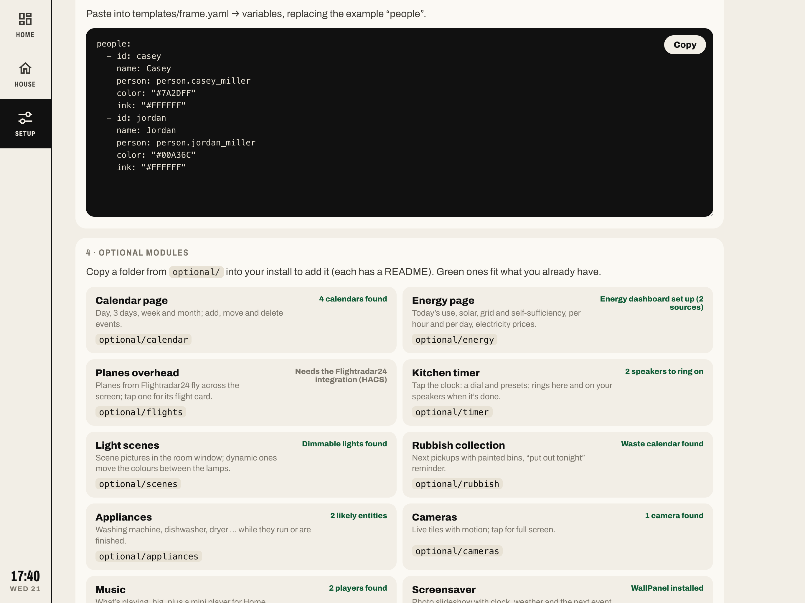

# Getting started

About 15 minutes from zero to a dashboard on the wall. You'll need file access to your `/config` folder: the **Studio Code Server**, **File editor**, **Samba** or **Advanced SSH & Web Terminal** add-on all work.

## 1. Install the cards (HACS)

In HACS, search for and download:

- **button-card** (required)
- **layout-card** (required)
- **kiosk-mode** (optional: hides Home Assistant's header and sidebar on the wall tablet)

HACS registers each card as a dashboard resource. Leave those entries in place.

## 2. Copy the files

The easiest way is the **Advanced SSH & Web Terminal** add-on: clone the repo and run the install script. Add the optional modules you want by name (see [optional/](../optional/)):

```bash
cd /tmp && git clone --depth 1 https://github.com/slcr/ha-frame-starter && ./ha-frame-starter/install.sh calendar energy
```

It copies:

| From this repo | To |
| --- | --- |
| `www/frame/` | `/config/www/frame/` |
| `dashboard/` | `/config/frame/` |
| `themes/frame.yaml` | `/config/themes/frame.yaml` |
| `optional/<name>/…` | the same places |

You can also copy these by hand with the File editor, Samba or Studio Code Server. To update later, pull the repo again and run the script: it replaces the code but keeps `templates/frame.yaml`, your views and the theme.

> If `/config/www` didn't exist before, restart Home Assistant once so it serves `/local/`.

## 3. configuration.yaml

Add the dashboard and the themes folder. If you already have a `lovelace:` or `frontend:` section, merge these lines into it:

```yaml
frontend:
  themes: !include_dir_merge_named themes

lovelace:
  dashboards:
    dashboard-frame:
      mode: yaml
      filename: frame/frame.yaml
      title: Frame
      icon: mdi:view-dashboard-variant-outline
      show_in_sidebar: true
```

Then restart Home Assistant (**Settings → System → Restart**).

## 4. Resources

Frame needs two more resources: its runtime and the fonts.

**Storage mode** (the default, if you've never set `lovelace: mode: yaml`): go to **Settings → Dashboards → ⋮ (top right) → Resources → Add resource**:

| URL | Type |
| --- | --- |
| `/local/frame/frame.js?v=1` | JavaScript module |
| `https://fonts.googleapis.com/css2?family=Archivo:wdth,wght@62..125,100..900&family=Instrument+Serif:ital@0;1&display=swap` | Stylesheet |

> Don't see Resources? Turn on **Advanced mode** in your user profile first.

**YAML mode** (`lovelace: mode: yaml`): add them under `lovelace: resources:` instead:

```yaml
lovelace:
  mode: yaml
  resources:
    - url: /local/frame/frame.js?v=1
      type: module
    - url: https://fonts.googleapis.com/css2?family=Archivo:wdth,wght@62..125,100..900&family=Instrument+Serif:ital@0;1&display=swap
      type: css
    # plus button-card and layout-card from /hacsfiles/...
```

## 5. Open the Setup page

Open **Frame** in the sidebar and tap **Setup** in the rail.


**1 · Install** checks the runtime, button-card, layout-card, the fonts, the theme and your weather entity. Every item that fails says how to fix it. Reload the page after each fix.

**2 · Entities in this dashboard** lists every entity the dashboard uses that doesn't exist in your Home Assistant, with likely matches from your own entities. Right after installing, that's almost all of them, because the dashboard ships with example entities like `light.living_room` and `person.alex`.

**3 · Generate YAML** writes cards from what your Home Assistant already has:


| Tab | Paste into |
| --- | --- |
| People | `templates/frame.yaml` → `variables:` (replace `people:`) |
| Calendars | the same place (replace `calendars:`). Check that `who` points at the right person. |
| Lights by area | `views/20-house.yaml`: one `frame_light` per area, controlling every light in it |
| Covers | `views/20-house.yaml`, next to the light of the same room |
| Climate | `views/20-house.yaml`: one `frame_rooms` card, one tile per area with a temperature sensor |
| Scenes | `views/20-house.yaml`: scene and script buttons |
| Windows & doors | anywhere. `frame_openings` also finds contact sensors on its own. |

**4 · Optional modules** lists every module in [optional/](../optional/) and marks the ones that fit what you have (green), with what's missing for the others.



## 6. Make it yours

1. Set `weather:` in `templates/frame.yaml` to your weather entity. It needs an hourly forecast; Met.no, the default integration, has one.
2. Replace `people` and `calendars`.
3. Go through `views/10-home.yaml` and `views/20-house.yaml`. Swap the example entities for yours and delete what you don't have. The Setup page counts down as you go.
4. When everything's green, delete `views/90-setup.yaml`. The rail drops the page by itself.

Changes to a YAML dashboard show up after a browser refresh. If an edit to an included file doesn't appear, save `frame.yaml` once as well (touch it) and refresh again. New files in `templates/` or `views/` are picked up the same way.

## 7. On the wall

- **Tablet:** the Home Assistant Companion app with its kiosk mode is the most reliable option. Fully Kiosk Browser works well on Android.
- Set the Companion app's default dashboard to Frame, or open `/dashboard-frame/home`.
- kiosk-mode hides the header and sidebar. Add `?disable_km` to the URL when you want to edit.
- Tap the small clock at the bottom of the rail to get to Settings (admins) or your profile.
- It's laid out for a 12.9" iPad in landscape (1366 × 1024) and fills anything from about 1000 px wide.

## Troubleshooting

### "Custom element doesn't exist: button-card" or "layout-card"

The card isn't installed or its resource is missing. Check HACS, then reload with the cache cleared.

### Cards are empty or unstyled

`frame.js` isn't loaded. Check the resource URL (`/local/frame/frame.js?v=1`) and that the file is at `/config/www/frame/frame.js`. The browser console shows `FRAME starter runtime 2 loaded` (or a newer number) when it works.

### I edited frame.js or frame.css and nothing changed

Browsers cache `/local/` files. Bump the `?v=` in the resource URL (`?v=2`) and reload.

### After an update: "this browser still runs the old frame.js", or ButtonCardJSTemplateError on the clock and weather

The templates are newer than the `frame.js` your browser runs. Either `install.sh` didn't run after `git pull` (pulling alone doesn't copy anything into `/config`), or the browser still has the old file cached. Run `./install.sh` again with your modules, raise `?v=` on the `frame.js` resource and reload. On a wall tablet you may also need to clear the app's cache.

### A file under /local/ gives 404 even though it's there

Home Assistant remembers 404s for `/local/` until it restarts. Restart once after adding new files.

### Weather shows "No hourly forecast"

Your weather integration only has daily forecasts. Try Met.no or Pirate Weather, or remove the hourly strip.

When the weather integration is down for a while (Open-Meteo times out now and then and the entity goes unavailable), Frame keeps showing the last forecast it got, for up to 12 hours and across reloads, and asks again every minute.

### Climate tiles have no sparkline

The sensor has no long-term statistics. It needs `state_class: measurement` (most temperature and humidity sensors have it), and the line only appears after an hour or two of data.

### Calendar is empty

Check `calendars:` in `templates/frame.yaml`. The entities must exist (`calendar.…`) and the user needs access to them.
