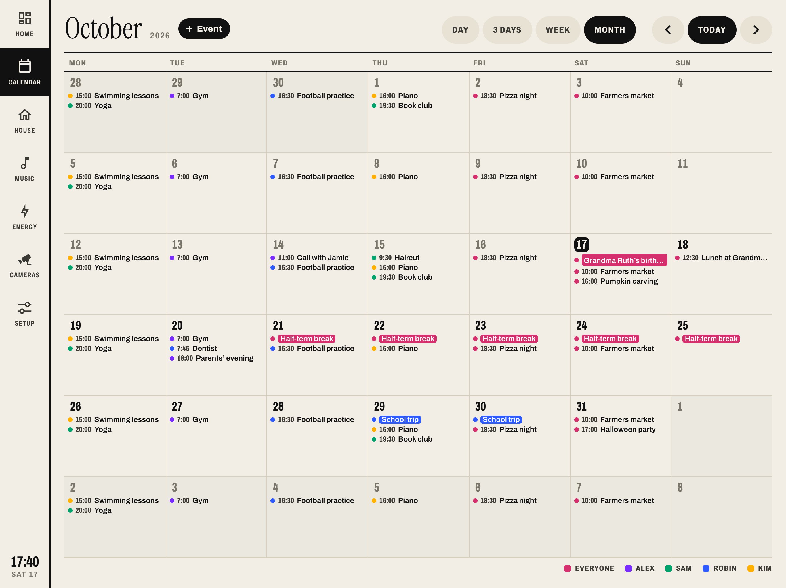
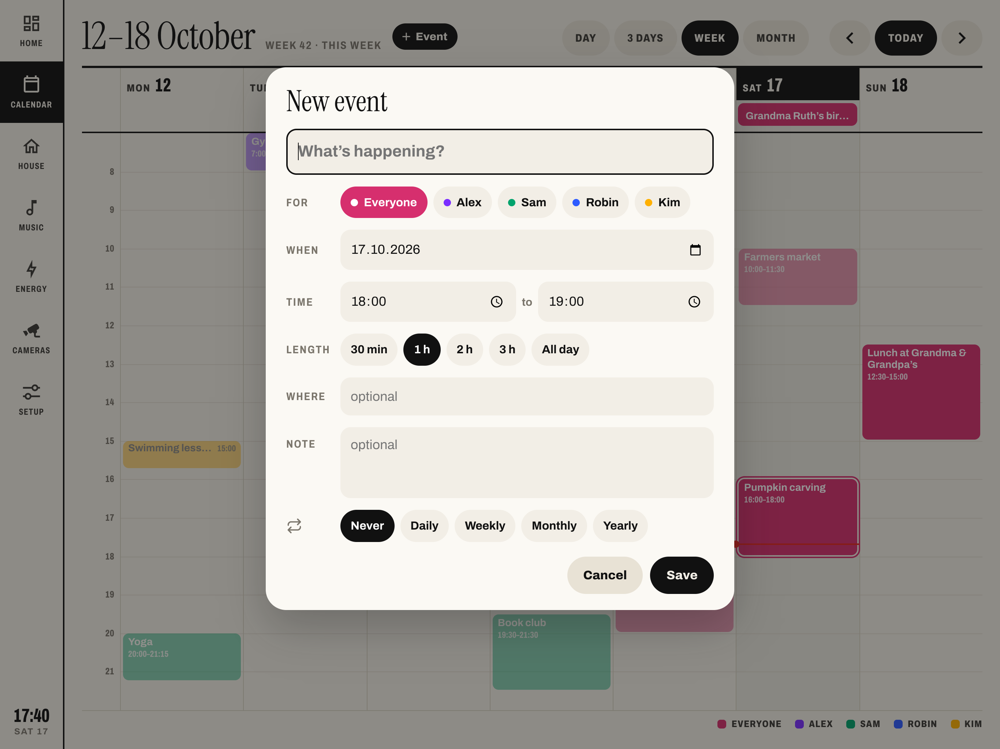

# Calendar page


Day, 3 days, week or month from the `calendars` in `templates/frame.yaml`, in the colours of their people.

- **Tap an empty spot** for a new event, with day and time filled in. **Tap an event** for details, then Edit or Delete.
- **Hold an event and drag** to move it: in 15-minute steps, to another day, or into the all-day row and back.
- **Swipe** or scroll sideways to turn pages. After 5 minutes it returns to today.
- Every change is written to the logbook and can be undone for 10 seconds.
- Repeating events: pick Daily/Weekly/Monthly/Yearly. Changing one event of a series asks whether it's just this one or all following.

 

## Install

```bash
./install.sh calendar
```

There's no last step: it uses your `calendars`. Mark calendars you don't want edited (holidays, shared ones) with `readonly: true`:

```yaml
calendars:
  - entity: calendar.holidays
    who: family
    readonly: true
```

Editing works with any calendar that supports creating and deleting events through Home Assistant (Local calendar, Google, CalDAV). Events are changed by creating the new version and deleting the old one, because many providers can't update in place.

## Options (`frame_calendar`)

| Variable | Default | |
| --- | --- | --- |
| `view` | `week` | Start view: `day`, `three`, `week`, `month` |
| `start_hour` / `end_hour` | 7 / 22 | Hours of the time grid |

The week starts on the day set in your profile (or your language's default).
