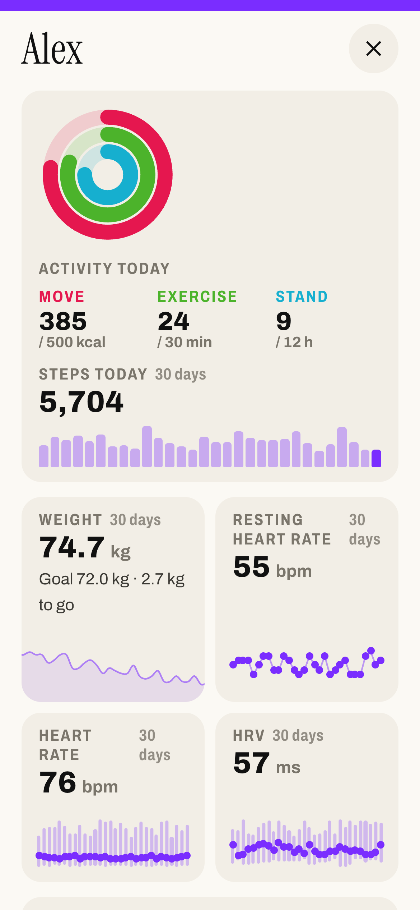

# Health


Tap a person in the "who's home" card on Home for their health window, in their own colour:

- **Activity today:** the move, exercise and stand rings as on the Apple Watch, with today's steps and the last 30 days as bars.
- **Tiles:** weight (with the goal and how far to go), resting heart rate, heart rate and HRV, each with the last 30 days. Heart rate and HRV show the day's span with its average.
- **Last night:** how long you slept, the stages over the night (awake, REM, core, deep) like in the Health app, the time per stage, and the last 30 nights.

Tap a chart for the values of a day. The window only opens on a tap, since visitors see the wall too, and it closes by itself after 60 seconds. People without health sensors can't be tapped.



## Where the data comes from

Apple Health has no way into Home Assistant by itself. The iPhone app **Health Auto Export – JSON+CSV** (App Store) sends it: an automation in the app posts your health data as JSON to a Home Assistant webhook every hour or two, and `packages/frame_health.yaml` turns it into sensors. Automations are part of the app's paid tier.

The weight comes from any smart scale integration (Withings, Xiaomi, Renpho …) or any sensor with your weight. It's optional, like every other value.

Each person sends from their own iPhone to their own webhook, because the data itself doesn't say whose it is.

## Install

1. `./install.sh health`. This copies the window, `packages/frame_health.yaml` into `/config/packages/` and `custom_templates/frame_health.jinja` into `/config/custom_templates/`.
2. If you don't use packages yet, add this to `configuration.yaml`:

   ```yaml
   homeassistant:
     packages: !include_dir_named packages
   ```

3. In `/config/packages/frame_health.yaml`, replace `alex` / `Alex` with the person and set `webhook_id` to something long and random (anyone who knows it can send values). For another person, copy the whole block from `- triggers:` down. Restart Home Assistant.
4. Set up the app on each iPhone (below). After the first upload, `sensor.alex_health_export` shows when it arrived, and its `metrics` attribute lists what came in.
5. In `templates/frame.yaml`, uncomment `health:` and list the sensors per person `id` from `people`. Leave out what you don't have. Reload, tap the person.

## Health Auto Export

In the app on the person's iPhone, under **Automations**, add a new automation:

| Setting | Value |
| --- | --- |
| Automation type | REST API |
| URL | `https://<your Home Assistant>/api/webhook/<webhook_id>`, an address that works away from home (Home Assistant Cloud or your own external URL) |
| Data type | Health Metrics |
| Metrics | Step Count, Resting Heart Rate, Heart Rate, Heart Rate Variability, Active Energy, Apple Exercise Time, Apple Stand Hour, Sleep Analysis |
| Export format | JSON |
| Date range | Today |
| Summarize data | On |
| Sync cadence | Every 1 hour |

That's enough for every tile, the rings and last night's totals. For the **stages over the night**, add a second automation with the same URL, only **Sleep Analysis**, **Summarize data off** and date range **Today** (the app counts a night to the day it ends on). With summarised data the app only sends HRV's average; HRV min and max fill in from this second automation if you add Heart Rate Variability to it too.

iOS only lets the app read Health data while the iPhone is unlocked, so uploads happen when the phone is in use. Sleep needs an Apple Watch (or another sleep tracker that writes to Apple Health) worn at night.

## Options (`health:`)

Per person `id`:

| | |
| --- | --- |
| `weight`, `goal` | Weight and target weight in kg |
| `steps` | Steps today |
| `rhr` | Resting heart rate |
| `hr`, `hr_min`, `hr_max` | Heart rate: the day's average, lowest and highest |
| `hrv`, `hrv_min`, `hrv_max` | HRV: the day's average, lowest and highest |
| `sleep` | Last night (with the stages in its attributes) |
| `move`, `exercise`, `stand` | The rings, with `move_goal` (kcal), `exercise_goal` (min) and `stand_goal` (h) as on the watch |
| `sync` | `sensor.<person>_health_export`: shows when Apple Health last sent data |

All words can be changed with `text:` in the household settings; the keys start with `hl_` in `TEXT` at the top of `www/frame/frame.js`.
